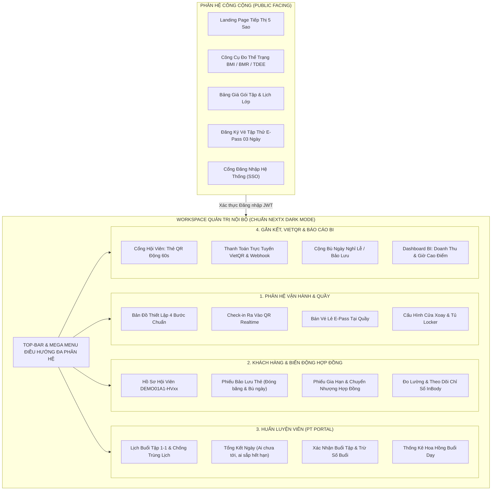

# BẢN KẾ HOẠCH TRIỂN KHAI VÀ TÁI CẤU TRÚC HỆ THỐNG CITYGYM
## THEO MÔ HÌNH CHUẨN THƯƠNG MẠI NEXTX GYM MASTER (CLOUD SAAS)

> **Đề tài Luận văn Tốt nghiệp:** XÂY DỰNG HỆ THỐNG WEBSITE QUẢN LÝ PHÒNG GYM TÍCH HỢP ĐẶT LỊCH PT, THANH TOÁN TRỰC TUYẾN VÀ CỔNG KHÁCH HÀNG  
> **Sinh viên thực hiện:** Võ Duy Phúc (MSSV: DH5200xxxx)  
> **Người hướng dẫn:** ThS. Bùi Nhật Bằng  
> **Đơn vị:** Khoa Công nghệ Thông tin – Trường Đại học Công nghệ Sài Gòn (STU)  
> **Hệ quy chiếu thực tế khảo sát:** Nền tảng NextX GymMaster (`nextx.vn` / `app.nextx.vn`)  

---

## I. TỔNG QUAN ĐỀ TÀI & MỤC TIÊU NÂNG CẤP

Hệ thống quản lý phòng gym truyền thống thường gặp các hạn chế: quản lý sổ sách rời rạc bằng Excel dễ thất thoát; phần mềm nước ngoài quá đắt đỏ và không hỗ trợ thanh toán nội địa VietQR; thiếu cổng tự phục vụ cho hội viên và huấn luyện viên PT.

Dựa trên kết quả khảo sát thực tế chuyên sâu từ 6 màn hình lõi của hệ thống thương mại **NextX GymMaster** (`app.nextx.vn`), đồ án tiến hành tái thiết kế toàn bộ hệ thống **CITYGYM** theo mô hình **All-in-One Cloud Workspace**, tích hợp khép kín từ khâu tiếp thị số đến vận hành quầy và tương tác hội viên.



---

## II. THIẾT KẾ CHI TIẾT CÁC PHÂN HỆ CHUẨN NEXTX GYM MASTER

### 1. Thanh Header Top-Bar & Hệ Thống Mega Menu Đa Tầng
- **Tông màu thiết kế:** Giao diện Dark Theme cao cấp chuẩn SaaS hiện đại: Nền Slate-950 (`#0F172A`), xám đen Card (`#1E293B`), điểm nhấn Xanh Ngọc Lục Bảo (`#10B981`) kết hợp Đỏ Thể Thao CITYGYM (`#EF4444`).
- **Thanh Top-Bar gồm các thành phần:**
  1. **Brand Identity:** Logo `CITYGYM | GYM MASTER` kèm huy hiệu phiên bản số hóa.
  2. **Mega Menu Dropdown (4 nhóm chức năng chuẩn NextX):**
     - **Menu Vận hành:** Bắt đầu/Thiết lập (Bản đồ 4 bước), Check-in/ra vào, Thiết bị & kết nối, Vé lẻ tập ngày, Lịch PT 1-1, Lịch lớp nhóm.
     - **Menu Khách hàng:** Hội viên, Hợp đồng, **Biến động hợp đồng (Phiếu bảo lưu, Phiếu gia hạn, Phiếu nâng cấp, Phiếu chuyển nhượng, Phiếu hủy)**, Đo lường InBody, Kênh Zalo App.
     - **Menu Huấn luyện:** Tập luyện hôm nay, Tổng kết ngày (học viên vắng, học viên sắp hết hạn), Lịch sử buổi tập, Thư viện giáo án & Dinh dưỡng.
     - **Menu Gắn kết:** Chương trình tích điểm Loyalty, Cộng ngày nghỉ lễ, Chiến dịch gửi tin nhắn/Email.
  3. **Công cụ tìm kiếm thông minh (`Ctrl + K`):** Tra cứu tức thì hội viên theo Tên, Số điện thoại hoặc Mã thẻ.
  4. **Bộ chọn chi nhánh:** `Chi nhánh STU - Quận 8` (hỗ trợ mở rộng chuỗi phòng tập).
  5. **Quick Role Switcher:** Thanh công cụ chuyển đổi nhanh 5 vai trò để bảo vệ đồ án: *Khách vãng lai, Lễ tân, PT, Hội viên, Quản trị viên*.

---

### 2. Phân Hệ 1: Vận Hành & Cửa Quầy (Operations & Check-in)
- **Bản đồ thiết lập 4 bước chuẩn hóa:**
  - *Bước 1: Cơ sở & Khu vực:* Thiết lập phòng tạ, phòng yoga, bể bơi, khung giờ mở cửa và sơ đồ tủ đồ locker.
  - *Bước 2: Gói tập & Giá:* Thiết lập danh mục gói `CityBasic`, `CityPro`, `CityVIP`, gắn quyền lợi và giá vé lẻ.
  - *Bước 3: Hợp đồng & Thu tiền:* Cấu hình tài khoản quỹ nhận tiền VietQR, chính sách bảo lưu và mẫu in hợp đồng STU Form 01.
  - *Bước 4: Nhân sự & PT:* Danh sách HLV, khung giờ làm việc và tỷ lệ hoa hồng buổi dạy.
- **Màn hình Quét Check-in Realtime (Camera / Đầu đọc QR):**
  - Tốc độ phản hồi cực nhanh (< 0.5s), tự động phân giải token QR từ điện thoại hội viên.
  - **Xử lý 3 kịch bản nghiệp vụ thực tế có âm thanh phản hồi:**
    - `HỢP LỆ (Thành công - Xanh)`: Thẻ đang hiệu lực `ACTIVE` $\rightarrow$ Phát chuông Beep thành công, mở cổng Turnstile, hiển thị số ngày còn lại của gói tập.
    - `TỪ CHỐI - BẢO LƯU (Cảnh báo - Vàng)`: Gói tập đang ở trạng thái `FROZEN` $\rightarrow$ Phát còi cảnh báo: *"Hợp đồng đang tạm ngưng bảo lưu, không thể check-in. Vui lòng mở lại hợp đồng tại quầy!"*.
    - `TỪ CHỐI - HẾT HẠN (Lỗi - Đỏ)`: Thẻ đã `EXPIRED` $\rightarrow$ Phát còi báo lỗi: *"Gói tập đã hết hạn, mời đăng ký gia hạn!"*.
- **Quầy bán vé lẻ (E-Pass):** Phát hành vé tập ngày cho khách vãng lai trực tiếp tại quầy hoặc đồng bộ từ lượt đăng ký tập thử trên Landing Page.

---

### 3. Phân Hệ 2: Khách Hàng & Biến Động Hợp Đồng (Nghiệp vụ đắt giá nhất)
- **Bảng Quản lý Danh sách Hội viên:**
  - Chuẩn hóa mã thẻ theo mã định danh chuyên nghiệp: `DEMO01A1-HV01`, `DEMO01A1-HV02`...
  - Bảng dữ liệu đa cột: Mã HV, Họ tên, Số điện thoại, Loại gói (`STANDARD`, `VIP`, `PT`), Chi nhánh, Tổng giá trị hợp đồng, Số tiền đã thanh toán, Công nợ còn lại, Hạn sử dụng và Trạng thái (`ACTIVE`, `FROZEN`, `EXPIRED`).
- **Phân hệ Biến động Hợp đồng (Contract Mutations):**
  - **Phiếu Bảo Lưu Hợp Đồng (Freeze Contract):**
    - Nghiệp vụ: Hội viên tạm ngừng tập do công tác/sức khỏe.
    - Thao tác: Nhập Ngày bắt đầu bảo lưu $\rightarrow$ Ngày dự kiến mở lại $\rightarrow$ Lý do bảo lưu.
    - Xử lý hệ thống: Chuyển trạng thái thẻ sang `FROZEN`, khóa quyền Check-in tại quầy; khi mở lại hợp đồng, hệ thống tự động tính số ngày bảo lưu thực tế và **cộng bù vào hạn sử dụng mới**.
  - **Phiếu Gia Hạn (Renew Contract):** Kéo dài thời hạn hợp đồng cũ kèm áp dụng chính sách ưu đãi khách hàng thân thiết.
  - **Phiếu Chuyển Nhượng (Transfer Contract):** Sang tên hợp đồng sang chủ sở hữu mới kèm phí chuyển nhượng theo quy định.
- **Phân hệ Đo lường InBody:**
  - Form nhập thông số thể trạng: Chiều cao, Cân nặng, % Mỡ cơ thể (Body Fat), Khối lượng cơ bắp (SMM), Huyết áp, Nhịp tim.
  - Hệ thống tự động tính: Chỉ số khối cơ thể `BMI`, Năng lượng trao đổi chất cơ bản `BMR`, Tổng mức tiêu hao năng lượng ngày `TDEE`.
  - Biểu đồ đường (Line Chart) theo dõi sự thay đổi thể trạng qua các tuần tập luyện.

---

### 4. Phân Hệ 3: Cổng Huấn Luyện Viên PT (Trainer Portal)
- **Lịch tập 1-1 hôm nay:**
  - Hiển thị danh sách các khung giờ tập kèm cá nhân đã được đặt trong ngày (ví dụ: `18:00 - 19:00 | Võ Duy Phúc | Tăng cơ vai & ngực`).
  - Hệ thống tự động chống xung đột trùng lịch (Concurrency Lock) bằng CSDL Transaction.
- **Màn hình Tổng kết ngày (Daily Retention & Warning):**
  - Danh sách học viên chưa đến tập trong ngày để PT chủ động gọi điện nhắc nhở.
  - Danh sách học viên sắp hết hạn gói tập (còn dưới 3 buổi) để PT tư vấn tái ký hợp đồng mới.
- **Điểm danh & Trừ buổi tập tự động:**
  - Huấn luyện viên bấm nút **"Xác nhận hoàn thành buổi tập"**.
  - Hệ thống tự động:
    1. Cập nhật trạng thái buổi tập thành `COMPLETED`.
    2. Trừ 1 buổi tập trong hợp đồng của học viên (`remainingSessions = remainingSessions - 1`).
    3. Ghi nhận hoa hồng buổi dạy vào tài khoản của PT.

---

### 5. Phân Hệ 4: Cổng Hội Viên, VietQR & Báo Cáo BI
- **Cổng Hội viên cá nhân (Self-Service Member Portal):**
  - **Thẻ thành viên điện tử (Dynamic E-Card):** Mã QR động tự động làm mới sau mỗi 60 giây (Dynamic Time-based Token) chống việc chụp màn hình chia sẻ cho người khác dùng chung.
  - Đặt lịch tập PT: Cho phép hội viên xem lịch trống của Huấn luyện viên và chủ động chọn giờ tập.
  - Xem số buổi tập còn lại, hạn thẻ và lịch sử chỉ số InBody.
- **Cổng Thanh toán Trực tuyến VietQR (Napas247):**
  - Sinh mã VietQR chuyển khoản động tích hợp đúng số tài khoản, tên chủ tài khoản, mã đơn hàng và số tiền chính xác từng đồng.
  - Đồng hồ đếm ngược giao dịch 15:00 phút.
  - Nút **"Giả lập Webhook Ngân hàng"** giúp demo đối soát tự động gạch nợ và kích hoạt gói tập ngay lập tức trước mặt hội đồng chấm thi.
- **Dashboard Quản trị BI (Business Intelligence):**
  - Báo cáo tổng doanh thu tháng, số lượng hợp đồng mới, tỷ lệ khách chuyển đổi từ tập thử sang hội viên chính thức.
  - Biểu đồ nhiệt (Heatmap) thể hiện khung giờ cao điểm trong ngày giúp ban quản lý bố trí nhân sự phù hợp.

---

## III. THIẾT KẾ CƠ SỞ DỮ LIỆU QUAN HỆ (PRISMA / MYSQL SCHEMA)

```prisma
// CSDL Quan hệ CITYGYM theo chuẩn NextX
model User {
  id            Int             @id @default(autoincrement())
  email         String          @unique
  phone         String          @unique
  fullName      String
  role          Role            @default(MEMBER) // ADMIN, RECEPTION, TRAINER, MEMBER
  createdAt     DateTime        @default(now())
  memberships   Membership[]
  ptBookings    PtBooking[]     @relation("MemberBookings")
  trainerSlots  PtBooking[]     @relation("TrainerBookings")
  inbodyMetrics InBodyMetric[]
}

model Membership {
  id                Int                 @id @default(autoincrement())
  contractCode      String              @unique // VD: DEMO01A1-HV08
  userId            Int
  user              User                @relation(fields: [userId], references: [id])
  packageName       String              // Standard, VIP, PT
  packagePrice      Float
  startDate         DateTime
  endDate           DateTime
  remainingSessions Int                 @default(0)
  totalSessions     Int                 @default(0)
  status            MembershipStatus    @default(ACTIVE) // ACTIVE, FROZEN, EXPIRED
  mutations         ContractMutation[]
  checkinLogs       CheckInLog[]
}

model ContractMutation {
  id              Int             @id @default(autoincrement())
  membershipId    Int
  membership      Membership      @relation(fields: [membershipId], references: [id])
  mutationType    MutationType    // FREEZE (Bảo lưu), EXTEND (Gia hạn), TRANSFER (Chuyển nhượng)
  startDate       DateTime
  endDate         DateTime?
  freezeDays      Int             @default(0)
  reason          String?
  createdAt       DateTime        @default(now())
}

model CheckInLog {
  id              Int             @id @default(autoincrement())
  membershipId    Int?
  membership      Membership?     @relation(fields: [membershipId], references: [id])
  guestPhone      String?
  guestName       String?
  checkinType     CheckinType     // MEMBER, TRIAL_EPASS
  status          CheckinStatus   // SUCCESS, DENIED_FROZEN, DENIED_EXPIRED
  note            String?
  createdAt       DateTime        @default(now())
}

model PtBooking {
  id          Int             @id @default(autoincrement())
  memberId    Int
  member      User            @relation("MemberBookings", fields: [memberId], references: [id])
  trainerId   Int
  trainer     User            @relation("TrainerBookings", fields: [trainerId], references: [id])
  bookingDate DateTime
  timeSlot    String          // "18:00 - 19:00"
  status      BookingStatus   // SCHEDULED, COMPLETED, CANCELLED
  goal        String?
}

model InBodyMetric {
  id          Int      @id @default(autoincrement())
  userId      Int
  user        User     @relation(fields: [userId], references: [id])
  weight      Float    // kg
  height      Float    // cm
  bodyFat     Float    // %
  muscleMass  Float    // kg
  bmi         Float
  bmr         Float
  measuredAt  DateTime @default(now())
}
```

---

## IV. LỘ TRÌNH 5 BƯỚC TRIỂN KHAI (IMPLEMENTATION SPRINT)

| Bước | Hạng mục công việc chính | Sản phẩm đầu ra cụ thể |
| :---: | :--- | :--- |
| **Bước 1** | **Xây dựng Shell Giao diện Dark Theme & Top-Bar Mega Menu:**<br>- Tạo Top-Bar chuyên nghiệp chuẩn NextX (`nextx.vn`).<br>- Dropdown 4 Menu: Vận hành, Khách hàng, Huấn luyện, Gắn kết.<br>- Tích hợp bộ chọn chi nhánh và Quick Role Switcher. | Giao diện Header mới nhất, điều hướng mượt mà giữa toàn bộ các phân hệ. |
| **Bước 2** | **Nâng cấp Bảng Hội Viên & Module Biến Động Hợp Đồng:**<br>- Bảng dữ liệu chuẩn mã `DEMO01A1-HVxx` đầy đủ các cột số tiền & công nợ.<br>- Modal tạo **Phiếu Bảo Lưu Thẻ** (chọn ngày, khóa check-in, tính ngày bù).<br>- Modal **Phiếu Gia Hạn & Chuyển Nhượng**.<br>- Phân hệ nhập và vẽ biểu đồ thể trạng InBody. | Quản lý hội viên chuẩn xác 100% theo Ảnh 2 của NextX GymMaster. |
| **Bước 3** | **Hoàn thiện Phân Hệ Vận Hành & Quét Check-in Realtime:**<br>- Giao diện Bản đồ thiết lập 4 bước.<br>- Trình mô phỏng quét mã QR có âm thanh và còi cảnh báo chính xác 3 trạng thái: Hợp lệ, Từ chối do Bảo lưu, Từ chối do Hết hạn.<br>- Module bán vé lẻ E-Pass cho khách vãng lai. | Module Check-in sống động, trực quan để demo trước hội đồng. |
| **Bước 4** | **Hoàn thiện Cổng Huấn Luyện Viên PT & Tổng Kết Ngày:**<br>- Bảng phân ca tập 1-1 hôm nay.<br>- Báo cáo Tổng kết ngày: Học viên chưa đến tập & Học viên sắp hết hạn gói.<br>- Chức năng bấm hoàn thành buổi tập $\rightarrow$ trừ 1 buổi tập trong hợp đồng học viên $\rightarrow$ cộng hoa hồng PT. | Khớp hoàn toàn với Ảnh 3 của NextX GymMaster. |
| **Bước 5** | **Đồng bộ Luận Văn Tốt Nghiệp STU & Xuất File Word:**<br>- Cập nhật Chương 2, Chương 3 (Sơ đồ Use case, Class Diagram, Sequence Diagram, Database Diagram).<br>- Cập nhật Chương 4 (14 kịch bản kiểm thử tương ứng các chức năng mới).<br>- Chạy script biên dịch và tự động xuất ra file Word chuẩn STU. | File `LuanVan_TotNghiep_STU_VoDuyPhuc.docx` hoàn chỉnh 100%. |

---

## V. ĐỐI CHIẾU TIÊU CHÍ BẢO VỆ LUẬN VĂN KHOA CNTT - STU

1. **Tính Thực tiễn & Đột phá:** Đề tài không dừng lại ở mức đồ án sinh viên đơn giản, mà kế thừa và hiện thực hóa được các nghiệp vụ chuẩn mực của phần mềm thương mại hàng đầu Việt Nam (**NextX GymMaster**).
2. **Tính Toàn vẹn Kỹ thuật (Technical Integrity):**
   - Áp dụng kiểm soát đồng thời (Concurrency Transaction) ngăn chặn 100% tình trạng đặt trùng lịch PT.
   - Thuật toán bảo lưu hợp đồng tự động tính toán chính xác số ngày đóng băng để cộng bù vào hạn thẻ mới.
   - Mã QR động 60 giây chống gian lận dùng chung thẻ.
   - Tích hợp cổng VietQR đối soát tự động qua Webhook.
3. **Mức độ sẵn sàng Demo:** Có thanh chuyển đổi vai trò (Role Switcher) giúp người báo cáo có thể trình diễn trực tiếp mọi phân hệ trước thầy cô chỉ với 1 cú nhấp chuột mà không cần phải đăng xuất đăng nhập nhiều tài khoản phức tạp.

---
*Tài liệu này là kim chỉ nam kỹ thuật chính thức cho toàn bộ quá trình tái cấu trúc mã nguồn và hoàn thiện hồ sơ Luận văn tốt nghiệp CITYGYM.*

