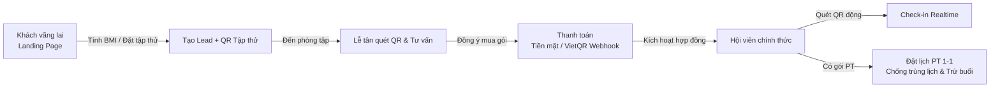
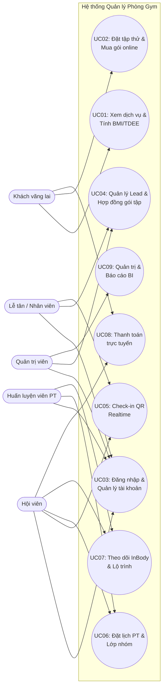

# Chương 2. PHƯƠNG PHÁP THỰC HIỆN

## 2.1 CÁC HỆ THỐNG TƯƠNG TỰ

Trước khi thiết kế hệ thống, luận văn tiến hành khảo sát một số phần mềm và nền tảng quản lý phòng gym phổ biến hiện nay trên thị trường Việt Nam và quốc tế để rút ra ưu, nhược điểm làm cơ sở hoàn thiện giải pháp:

| Hệ thống | Mô tả chung | Ưu điểm | Nhược điểm |
| :--- | :--- | :--- | :--- |
| **GymMaster** (Quốc tế) | Phần mềm quản lý phòng tập cloud toàn diện (hội viên, billing, cổng khách hàng, đặt lịch). | Đầy đủ nghiệp vụ chuyên sâu (bảo lưu, công nợ, đặt lịch PT, báo cáo BI, cổng thành viên). | Chi phí bản quyền cao tính theo USD/tháng; giao diện tiếng Anh phức tạp với nhân sự phòng gym nhỏ; chưa tích hợp thanh toán nội địa (VietQR/VNPay). |
| **PosApp / KiotViet Gym** (Việt Nam) | Phần mềm quản lý bán hàng mở rộng cho phòng tập, spa, fitness tại Việt Nam. | Giao diện tiếng Việt dễ dùng, quản lý tốt thu chi, bán gói, quét mã vạch/vân tay tại quầy. | Chủ yếu tập trung cho Lễ tân/Quản lý tại quầy; thiếu Landing Page tích hợp phễu Lead tự động, thiếu cổng cá nhân cho Hội viên tự đặt lịch PT hoặc theo dõi InBody. |
| **FitSW / Trainerize** (Quốc tế) | Nền tảng kết nối Huấn luyện viên cá nhân (PT) và học viên. | Mạnh về theo dõi chỉ số cơ thể, lên lịch tập, gợi ý dinh dưỡng và giao tiếp PT – học viên. | Không giải quyết bài toán vận hành phòng tập (check-in quầy lễ tân, bảo lưu hợp đồng, quản lý CRM khách tập thử, thanh toán gói tại Việt Nam). |

**Nhận xét và định hướng giải pháp:**  
Các hệ thống hiện có thường tách rời giữa *phần mềm quản trị nội bộ tại quầy*, *cổng tương tác PT – Hội viên* và *Landing Page tiếp cận khách vãng lai*. Đề tài của luận văn kết hợp cả 3 lớp này trên cùng một nền tảng Web đồng bộ với dữ liệu MySQL tập trung, tối ưu cho quy trình phòng gym tại Việt Nam (hỗ trợ VietQR/VNPay Sandbox, tiếng Việt, QR Code động không cần phần cứng đắt tiền).

---

## 2.2 CƠ SỞ LÝ THUYẾT

*(Lưu ý theo mẫu Khoa CNTT – STU: Đối với đề tài ứng dụng, mục này có thể trình bày ngắn gọn các công thức khoa học và mô hình bảo mật cốt lõi được áp dụng trong phần mềm hoặc lược bỏ theo yêu cầu của GVHD.)*

### 2.2.1 Các công thức đánh giá thể trạng và nhu cầu năng lượng
Hệ thống sử dụng các công thức chuẩn y khoa để hỗ trợ tính toán chỉ số trên Landing Page và cổng Hội viên:
- **Chỉ số khối cơ thể (BMI):** $\text{BMI} = \frac{\text{Cân nặng (kg)}}{[\text{Chiều cao (m)}]^2}$
- **Tỷ lệ trao đổi chất cơ bản (BMR – Công thức Mifflin-St Jeor):**
  - Nam: $\text{BMR} = 10 \times \text{Cân nặng (kg)} + 6.25 \times \text{Chiều cao (cm)} - 5 \times \text{Tuổi} + 5$
  - Nữ: $\text{BMR} = 10 \times \text{Cân nặng (kg)} + 6.25 \times \text{Chiều cao (cm)} - 5 \times \text{Tuổi} - 161$
- **Tổng năng lượng tiêu thụ hàng ngày (TDEE):** $\text{TDEE} = \text{BMR} \times R$, trong đó $R \in [1.2, 1.9]$ là hệ số mức độ vận động. Từ TDEE, hệ thống điều chỉnh lượng calo mục tiêu (giảm mỡ: $-300$ đến $-500\text{ kcal}$; tăng cơ: $+300$ đến $+500\text{ kcal}$).

### 2.2.2 Mô hình kiểm soát truy cập dựa trên vai trò (RBAC)
Hệ thống áp dụng mô hình **RBAC (Role-Based Access Control)** kết hợp **JSON Web Token (JWT)**. Quyền hạn được gán theo vai trò (`MEMBER`, `PT`, `STAFF`, `ADMIN`) thay vì gán rời rạc cho từng tài khoản, giúp kiểm soát truy cập nhất quán ở cả giao diện (Frontend Route Guard) và API máy chủ (Backend Middleware).

---

## 2.3 CÔNG NGHỆ SỬ DỤNG

Hệ thống được xây dựng theo kiến trúc **Client – Server** tách biệt Frontend và Backend, giao tiếp qua **RESTful API** và **WebSocket (Socket.io)**:

| Nhóm | Công nghệ | Vai trò & Mô tả sơ lược trong luận văn |
| :--- | :--- | :--- |
| **Frontend** | **React 18 + TypeScript + Vite** | Xây dựng giao diện SPA mượt mà cho cả 3 phân vùng: Landing Page, Cổng Hội viên/PT và Dashboard Admin/Lễ tân. |
| | **Tailwind CSS + Ant Design** | Thiết kế giao diện hiện đại, đáp ứng đa thiết bị (Responsive); Ant Design hỗ trợ các bảng dữ liệu, form nghiệp vụ phức tạp. |
| | **TanStack Query & Recharts** | Quản lý trạng thái bất đồng bộ, cache API và vẽ biểu đồ thống kê doanh thu, cân nặng, giờ cao điểm. |
| | **Socket.io-client, `qrcode.react`, `html5-qrcode`** | Sinh mã QR động trên cổng Hội viên và quét mã QR trực tiếp bằng camera trình duyệt tại quầy Lễ tân. |
| **Backend** | **Node.js + Express.js + TypeScript** | Xây dựng máy chủ API theo kiến trúc phân lớp (`Routes → Controllers → Services → Prisma`), xử lý logic nghiệp vụ. |
| | **Prisma ORM** | Tương tác an toàn với MySQL, quản lý schema, migration và thực thi Transaction chống xung đột dữ liệu. |
| | **Socket.io & `node-cron`** | Đẩy thông báo check-in Realtime lên màn hình Lễ tân; chạy tác vụ tự động mở bảo lưu và cập nhật gói hết hạn. |
| | **JWT, Bcrypt, Nodemailer** | Xác thực người dùng, mã hóa mật khẩu và gửi email xác nhận vé tập thử / hóa đơn. |
| **Database** | **MySQL 8.0** | Hệ quản trị cơ sở dữ liệu quan hệ lưu trữ toàn bộ dữ liệu người dùng, hợp đồng, lịch tập, giao dịch và chỉ số cơ thể. |
| **Thanh toán & Triển khai** | **PayOS / VNPay (Sandbox), Docker** | Mô phỏng thanh toán trực tuyến qua Webhook tự động đối soát; đóng gói môi trường MySQL và ứng dụng bằng Docker. |

---

## 2.4 PHÂN TÍCH YÊU CẦU

### 2.4.1 Các quy trình, nghiệp vụ

Hệ thống xoay quanh 5 quy trình nghiệp vụ cốt lõi sau:

#### a) Quy trình Tiếp nhận Khách vãng lai & Chuyển đổi Lead (Landing Page → CRM)
1. Khách vãng lai truy cập Landing Page để xem bảng giá gói tập, lịch lớp nhóm, hồ sơ PT hoặc sử dụng công cụ tính **BMI/BMR/TDEE**.
2. Khách điền form **Đăng ký tập thử miễn phí** (họ tên, SĐT, email, ngày hẹn).
3. Hệ thống tạo bản ghi `Lead` (trạng thái `NEW`) và `TrialBooking` kèm **mã QR vé tập thử**, gửi email xác nhận cho khách.
4. Khi khách đến phòng tập, Lễ tân quét mã QR vé tập thử → cập nhật trạng thái `TRIAL_CHECKED_IN`. Sau buổi tập, Lễ tân tư vấn chốt gói và chuyển đổi Lead thành **Hội viên (`CONVERTED`)**.

#### b) Quy trình Đăng ký, Gia hạn, Bảo lưu và Chuyển nhượng gói tập
1. Hội viên hoặc Lễ tân chọn gói tập (theo thời hạn hoặc theo số buổi PT), áp dụng mã khuyến mãi (nếu có).
2. Thanh toán tại quầy (tiền mặt) hoặc trực tuyến (VietQR/VNPay Sandbox). Khi thanh toán thành công, hợp đồng chuyển sang trạng thái `ACTIVE`.
3. **Nghiệp vụ Bảo lưu (Freeze):** Hội viên gửi yêu cầu bảo lưu trong khoảng thời gian hợp lệ (`freeze_start` → `freeze_end`). Hệ thống chuyển hợp đồng sang `FROZEN` (tạm khóa check-in). Khi hết hạn bảo lưu (hoặc mở lại sớm), Cron Job/Lễ tân kích hoạt lại và **cộng bù đúng số ngày đã bảo lưu** vào `end_date`.
4. **Nghiệp vụ Chuyển nhượng:** Lễ tân chọn hợp đồng còn hiệu lực và hội viên nhận chuyển nhượng; hệ thống thực hiện trong Transaction: đóng hợp đồng cũ (`TRANSFERRED`), tạo/kích hoạt hợp đồng cho người nhận và lưu vết lịch sử.

#### c) Quy trình Check-in bằng QR Code động (Realtime)
1. Hội viên mở cổng cá nhân, hệ thống sinh mã QR chứa **JWT token ngắn hạn (60 giây)** tự động làm mới để chống chụp ảnh gửi dùng chung.
2. Tại quầy, Lễ tân dùng camera trình duyệt quét mã QR.
3. Backend xác thực token, kiểm tra hợp đồng của hội viên:
   - Nếu có gói `ACTIVE` và còn hạn → ghi nhận `check_ins` (`SUCCESS`), phát sự kiện **Socket.io** hiển thị thông tin hội viên (ảnh, tên, số ngày/buổi còn lại) lên màn hình Lễ tân.
   - Nếu gói `FROZEN` hoặc `EXPIRED` → ghi nhận `DENIED` kèm lý do và phát cảnh báo đỏ trên màn hình Lễ tân.

#### d) Quy trình Đặt lịch PT 1-1 và Tính hoa hồng
1. Hội viên có gói PT còn buổi (`remaining_sessions > 0`) chọn PT và khung giờ trống.
2. Backend mở **MySQL Transaction**, kiểm tra xem PT hoặc Hội viên có lịch trùng trong khoảng thời gian đó không. Nếu hợp lệ mới tạo lịch `SCHEDULED`.
3. Khi buổi tập kết thúc, PT bấm xác nhận hoàn thành (`COMPLETED`) → hệ thống **trừ 1 buổi** trong `remaining_sessions` của hợp đồng. Nếu hội viên hủy trễ quy định (`CANCELLED_LATE`), vẫn bị trừ buổi; hủy đúng hạn (`CANCELLED_ON_TIME`) không mất buổi.
4. Cuối tháng, hệ thống tổng hợp số buổi `COMPLETED` và doanh số bán gói của từng PT để tính **bảng hoa hồng (Commission)**.

#### e) Quy trình Thanh toán trực tuyến qua Webhook
1. Người dùng chọn mua/gia hạn gói tập → Backend tạo đơn thanh toán trạng thái `PENDING` và gọi API cổng thanh toán (Sandbox) lấy mã VietQR / URL thanh toán.
2. Sau khi người dùng thanh toán, cổng thanh toán gọi **Webhook** về Backend.
3. Backend xác thực chữ ký Webhook, kiểm tra đơn hàng chưa xử lý trước đó, cập nhật `payments` sang `PAID` và kích hoạt `memberships` trong cùng một Transaction.

---

### 2.4.2 Sơ đồ chức năng

Hệ thống được phân rã thành **5 phân hệ chức năng chính** như minh họa dưới đây:

```mermaid
flowchart TD
    Root[HỆ THỐNG QUẢN LÝ PHÒNG GYM]
    Root --> M1[1. Cổng Khách vãng lai<br/>Landing Page]
    Root --> M2[2. Quản lý Hội viên<br/>& Hợp đồng]
    Root --> M3[3. Vận hành &<br/>Kiểm soát ra vào]
    Root --> M4[4. Lịch tập PT &<br/>Theo dõi thể trạng]
    Root --> M5[5. Thanh toán &<br/>Báo cáo thống kê]

    M1 --> M1a[Xem gói tập, PT, lịch lớp]
    M1 --> M1b[Tính BMI / BMR / TDEE]
    M1 --> M1c[Đặt lịch tập thử QR]
    M1 --> M1d[Mua gói trực tuyến]

    M2 --> M2a[CRM Quản lý Lead]
    M2 --> M2b[Đăng ký / Gia hạn gói]
    M2 --> M2c[Bảo lưu & Chuyển nhượng]

    M3 --> M3a[Sinh mã QR động]
    M3 --> M3b[Quét QR Check-in Realtime]
    M3 --> M3c[Quản lý lớp GroupX]

    M4 --> M4a[Đặt / Hủy lịch PT 1-1]
    M4 --> M4b[Xác nhận buổi & Trừ buổi]
    M4 --> M4c[Chỉ số InBody & Lộ trình]

    M5 --> M5a[Thanh toán Sandbox & Webhook]
    M5 --> M5b[Tính hoa hồng PT]
    M5 --> M5c[Dashboard BI Doanh thu & Retention]
```

*(Ghi chú: Khi đưa vào Word, bạn có thể xuất sơ đồ Mermaid này hoặc vẽ lại bằng Draw.io/Visio thành `Hình 2-1: Sơ đồ phân rã chức năng hệ thống` theo quy chuẩn hình vẽ của STU).*

---

### 2.4.3 Sơ đồ Use case tổng quát

#### a) Mô tả các tác nhân (Actors)

| STT | Tác nhân (Actor) | Mô tả vai trò |
| :---: | :--- | :--- |
| 1 | **Khách vãng lai (Guest)** | Người dùng chưa đăng nhập truy cập Landing Page để tìm hiểu dịch vụ, tính chỉ số sức khỏe, đặt lịch tập thử hoặc đăng ký mua gói mới. |
| 2 | **Hội viên (Member)** | Khách hàng đã có tài khoản và hợp đồng; sử dụng hệ thống để check-in QR, đặt lịch PT/lớp nhóm, gia hạn/bảo lưu và theo dõi chỉ số cơ thể. |
| 3 | **Huấn luyện viên (PT)** | Nhân sự chuyên môn phụ trách dạy 1-1 hoặc lớp nhóm; quản lý lịch dạy, xác nhận hoàn thành buổi tập, cập nhật chỉ số InBody và xem hoa hồng. |
| 4 | **Lễ tân / Nhân viên (Staff)** | Nhân sự vận hành tại quầy; quản lý Lead tập thử, hỗ trợ bán gói/gia hạn/bảo lưu/chuyển nhượng, thu tiền mặt và quét QR check-in. |
| 5 | **Quản trị viên (Admin)** | Người quản lý cao nhất; thiết lập gói tập, khuyến mãi, nhân sự, phân quyền và theo dõi báo cáo thống kê toàn phòng tập. |

#### b) Mô tả sơ lược các nhóm Use case tổng quát

- **UC01 – Tra cứu dịch vụ & Tính BMI/TDEE:** Khách vãng lai xem bảng giá gói tập, lịch lớp nhóm, hồ sơ PT và tính chỉ số sức khỏe.
- **UC02 – Đặt lịch tập thử & Đăng ký mua gói:** Khách đặt lịch tập thử nhận QR hoặc tạo tài khoản mua gói trực tuyến.
- **UC03 – Đăng nhập & Quản lý tài khoản:** Các tác nhân nội bộ xác thực bằng JWT, đổi mật khẩu, cập nhật thông tin cá nhân.
- **UC04 – Quản lý CRM Lead & Hợp đồng gói tập:** Lễ tân xử lý danh sách khách tập thử, tạo/gia hạn/bảo lưu/chuyển nhượng hợp đồng cho hội viên.
- **UC05 – Check-in QR Code:** Hội viên/Khách tập thử xuất trình QR; Lễ tân quét mã để kiểm soát ra vào theo thời gian thực.
- **UC06 – Đặt lịch PT 1-1 & Lớp nhóm:** Hội viên đặt/hủy lịch; PT xác nhận hoàn thành buổi tập; hệ thống chống trùng lịch và trừ buổi.
- **UC07 – Theo dõi chỉ số cơ thể & Lộ trình:** PT cập nhật chỉ số đo InBody; Hội viên xem biểu đồ tiến độ và lộ trình gợi ý.
- **UC08 – Thanh toán trực tuyến:** Xử lý thanh toán qua VietQR/VNPay Sandbox và tự động đối soát qua Webhook.
- **UC09 – Quản trị hệ thống & Báo cáo thống kê:** Admin quản lý nhân sự, gói tập, khuyến mãi, tính hoa hồng PT và xem Dashboard BI.

**<u>*Hình 2-1*</u>: Sơ đồ Use case tổng quát.**

