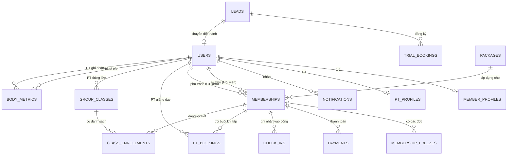
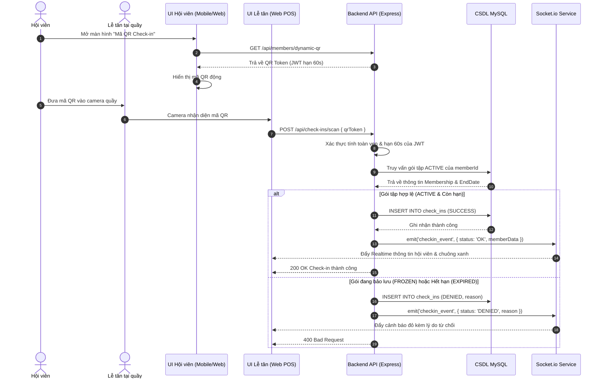
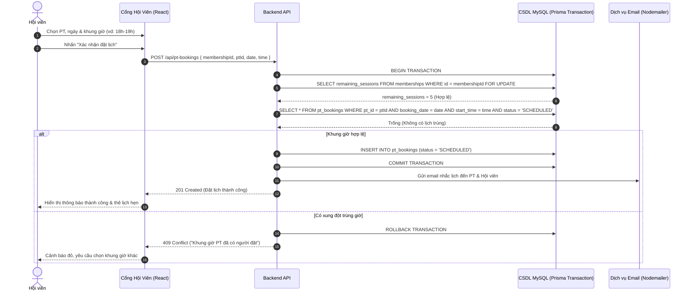
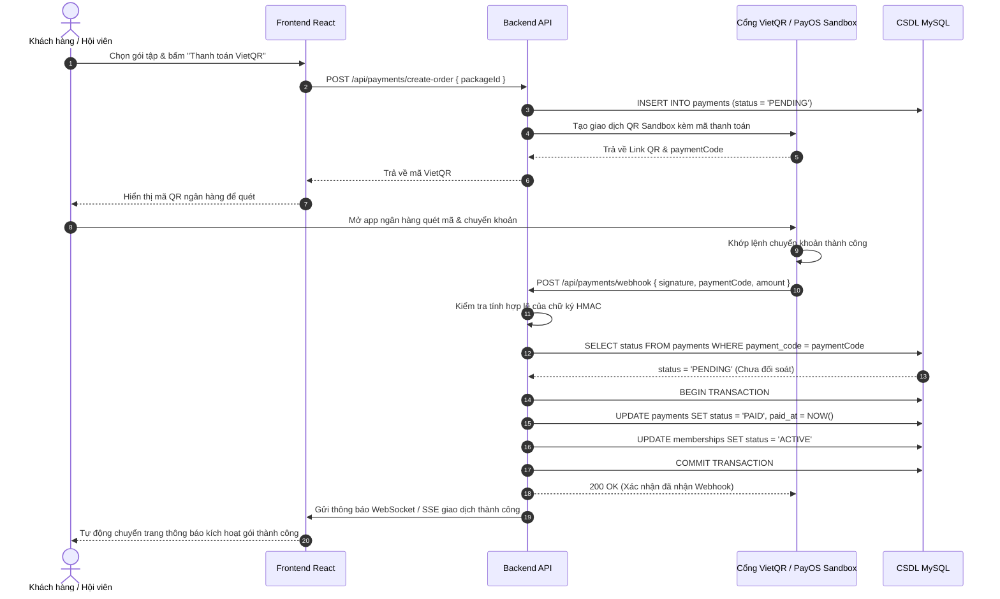
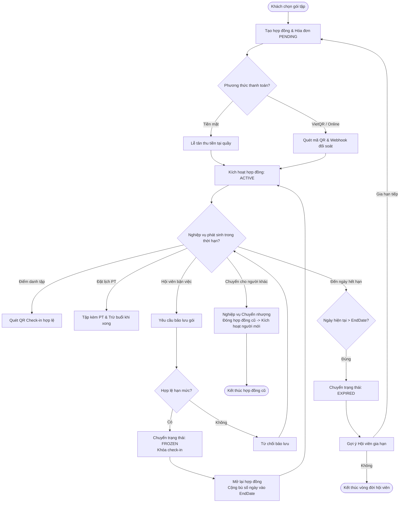
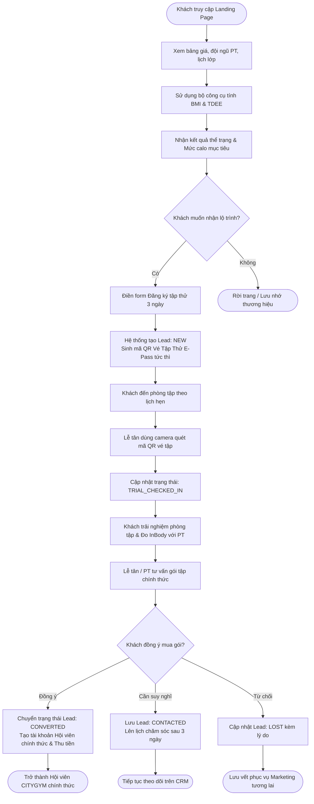

# Chương 3. THIẾT KẾ

## 3.1 MÔ HÌNH DỮ LIỆU

### 3.1.1 Mức ý niệm

Hệ thống quản lý phòng gym CITYGYM được thiết kế nhằm phục vụ toàn diện vòng đời của khách hàng từ giai đoạn khách vãng lai (Guest) tìm hiểu thông tin, đăng ký tập thử, cho đến khi trở thành hội viên chính thức (Member), tham gia các buổi tập kèm cùng Huấn luyện viên cá nhân (PT), tham gia lớp tập nhóm và theo dõi tiến trình thay đổi thể trạng.

Mô hình dữ liệu mức ý niệm bao gồm các thực thể cốt lõi sau:

1. **NGƯỜI DÙNG (Users):** Lưu trữ thông tin tài khoản dùng để xác thực và phân quyền (Admin, Staff, PT, Member).
2. **HỒ SƠ HỘI VIÊN (MemberProfiles):** Mở rộng thông tin cá nhân của hội viên (ngày sinh, giới tính, địa chỉ, mã bí mật sinh QR động).
3. **HỒ SƠ HUẤN LUYỆN VIÊN (PTProfiles):** Lưu trữ thông tin chuyên môn, chứng chỉ quốc tế, số năm kinh nghiệm, tỷ lệ hoa hồng và đánh giá xếp hạng của PT.
4. **KHÁCH TIỀM NĂNG (Leads):** Lưu vết thông tin khách vãng lai đăng ký từ Landing Page (họ tên, SĐT, dịch vụ quan tâm, kết quả đo BMI/TDEE ban đầu).
5. **LỊCH TẬP THỬ (TrialBookings):** Quản lý vé tập thử miễn phí 03 ngày, mã vé E-Pass QR và trạng thái đến phòng tập.
6. **GÓI TẬP (Packages):** Các gói dịch vụ phòng gym cung cấp (gói theo thời hạn, gói số buổi kèm PT, gói lớp nhóm).
7. **HỢP ĐỒNG HỘI VIÊN (Memberships):** Bản ghi hợp đồng kích hoạt gói tập của hội viên, ghi nhận ngày bắt đầu, ngày kết thúc, số buổi tập PT còn lại và trạng thái (`ACTIVE`, `FROZEN`, `EXPIRED`, `TRANSFERRED`).
8. **BẢO LƯU GÓI TẬP (MembershipFreezes):** Lưu thông tin các đợt tạm ngưng gói tập của hội viên (ngày bắt đầu bảo lưu, ngày dự kiến mở lại, ngày mở lại thực tế, lý do, người phê duyệt).
9. **THANH TOÁN (Payments):** Lưu vết giao dịch thu tiền (tiền mặt tại quầy, VietQR/PayOS hoặc VNPay Sandbox), mã tham chiếu ngân hàng và trạng thái gạch nợ.
10. **LỊCH CHECK-IN (CheckIns):** Nhật ký ra vào phòng tập theo thời gian thực (thời gian quét, loại vé, kết quả hợp lệ hay bị từ chối kèm lý do).
11. **LỊCH TẬP PT (PTBookings):** Quản lý khung giờ đặt lịch tập 1-1 giữa học viên và Huấn luyện viên, ghi nhận trạng thái hoàn thành để trừ buổi và tính hoa hồng.
12. **LỚP NHÓM (GroupClasses) & ĐĂNG KÝ LỚP (ClassEnrollments):** Quản lý lịch các bộ môn Yoga, HIIT, Zumba hàng tuần, giới hạn sĩ số lớp và danh sách hội viên đăng ký giữ chỗ.
13. **CHỈ SỐ THỂ TRẠNG (BodyMetrics):** Theo dõi lịch sử số đo cơ thể qua các lần kiểm tra InBody định kỳ (chiều cao, cân nặng, % mỡ, khối lượng cơ, BMI, BMR, TDEE).



**<u>*Hình 3-1*</u>: Sơ đồ thực thể mối quan hệ mức ý niệm (Conceptual ERD).**

---

### 3.1.2 Mức luận lý

Mô hình dữ liệu mức luận lý được chuẩn hóa đạt dạng chuẩn 3 (3NF) nhằm loại bỏ dư thừa dữ liệu và đảm bảo tính toàn vẹn quan hệ:

- **USERS** (<u>id</u>, email, phone, password_hash, full_name, avatar_url, role, status, created_at, updated_at)
- **MEMBER_PROFILES** (<u>user_id</u>, gender, dob, address, emergency_contact, qr_secret, notes)
  - *FK: user_id references USERS(id)*
- **PT_PROFILES** (<u>user_id</u>, specialty, bio, experience_years, cert_names, base_salary, commission_rate, rating_avg, is_available)
  - *FK: user_id references USERS(id)*
- **LEADS** (<u>id</u>, full_name, phone, email, interest_service, goal, initial_bmi, initial_tdee, source, status, assigned_staff_id, created_at)
  - *FK: assigned_staff_id references USERS(id)*
- **TRIAL_BOOKINGS** (<u>id</u>, lead_id, ticket_code, scheduled_date, time_slot, status, checked_in_at, created_at)
  - *FK: lead_id references LEADS(id)*
- **PACKAGES** (<u>id</u>, code, name, package_type, duration_days, pt_sessions, price, max_freeze_days, description, is_active)
- **MEMBERSHIPS** (<u>id</u>, member_id, package_id, assigned_pt_id, contract_code, start_date, end_date, remaining_sessions, status, total_amount, paid_amount, created_by)
  - *FK: member_id references USERS(id), package_id references PACKAGES(id), assigned_pt_id references USERS(id)*
- **MEMBERSHIP_FREEZES** (<u>id</u>, membership_id, freeze_start, freeze_end, actual_unfreeze_date, days_count, reason, approved_by, status, created_at)
  - *FK: membership_id references MEMBERSHIPS(id), approved_by references USERS(id)*
- **PAYMENTS** (<u>id</u>, membership_id, payment_code, amount, payment_method, gateway_trans_id, status, paid_at, note, processed_by)
  - *FK: membership_id references MEMBERSHIPS(id), processed_by references USERS(id)*
- **CHECK_INS** (<u>id</u>, member_id, membership_id, trial_booking_id, check_type, checkin_time, status, deny_reason, staff_id)
  - *FK: member_id references USERS(id), membership_id references MEMBERSHIPS(id), trial_booking_id references TRIAL_BOOKINGS(id)*
- **PT_BOOKINGS** (<u>id</u>, membership_id, member_id, pt_id, booking_date, start_time, end_time, status, pt_note, completed_at)
  - *FK: membership_id references MEMBERSHIPS(id), member_id references USERS(id), pt_id references USERS(id)*
- **GROUP_CLASSES** (<u>id</u>, class_name, pt_id, room_name, class_date, start_time, end_time, max_capacity, enrolled_count, status)
  - *FK: pt_id references USERS(id)*
- **CLASS_ENROLLMENTS** (<u>id</u>, class_id, membership_id, member_id, status, enrolled_at)
  - *FK: class_id references GROUP_CLASSES(id), membership_id references MEMBERSHIPS(id)*
- **BODY_METRICS** (<u>id</u>, member_id, pt_id, weight, height, body_fat_pct, muscle_mass_kg, bmi, bmr, tdee, measured_at, recommendations)
  - *FK: member_id references USERS(id), pt_id references USERS(id)*

---

### 3.1.3 Mức vật lý

Hệ thống sử dụng hệ quản trị cơ sở dữ liệu quan hệ **MySQL 8.0** với bảng mã ký tự `utf8mb4_unicode_ci` nhằm hỗ trợ đầy đủ tiếng Việt có dấu. Dưới đây là đặc tả chi tiết các bảng vật lý chủ chốt trong cơ sở dữ liệu:

#### Bảng 3-1: Đặc tả cấu trúc bảng `users`
| Tên trường | Kiểu dữ liệu | Khóa | Nullable | Mặc định | Ý nghĩa |
| :--- | :--- | :---: | :---: | :--- | :--- |
| `id` | INT AUTO_INCREMENT | PK | Không | | Định danh tài khoản duy nhất |
| `email` | VARCHAR(120) | Unique | Có | NULL | Email đăng nhập / nhận thông báo |
| `phone` | VARCHAR(15) | Unique | Không | | Số điện thoại đăng nhập chính |
| `password_hash` | VARCHAR(255) | | Không | | Mật khẩu băm (Bcrypt 10 rounds) |
| `full_name` | VARCHAR(100) | | Không | | Họ và tên đầy đủ |
| `avatar_url` | VARCHAR(255) | | Có | NULL | Đường dẫn ảnh đại diện |
| `role` | ENUM | | Không | 'MEMBER' | 'ADMIN', 'STAFF', 'PT', 'MEMBER' |
| `status` | ENUM | | Không | 'ACTIVE' | 'ACTIVE', 'BLOCKED', 'PENDING' |
| `created_at` | DATETIME | | Không | CURRENT_TIMESTAMP | Thời gian tạo tài khoản |
| `updated_at` | DATETIME | | Không | CURRENT_TIMESTAMP | Thời gian cập nhật gần nhất |

#### Bảng 3-2: Đặc tả cấu trúc bảng `packages` (Gói tập)
| Tên trường | Kiểu dữ liệu | Khóa | Nullable | Mặc định | Ý nghĩa |
| :--- | :--- | :---: | :---: | :--- | :--- |
| `id` | INT AUTO_INCREMENT | PK | Không | | Khóa chính gói tập |
| `code` | VARCHAR(30) | Unique | Không | | Mã gói tập (vd: `CITY_PRO_6M`, `PT_36S`) |
| `name` | VARCHAR(120) | | Không | | Tên hiển thị gói tập |
| `package_type` | ENUM | | Không | 'TIME_BASED' | 'TIME_BASED', 'PT_SESSION', 'COMBO' |
| `duration_days` | INT | | Không | 30 | Thời hạn gói tính theo ngày |
| `pt_sessions` | INT | | Không | 0 | Số buổi kèm PT (nếu có) |
| `price` | DECIMAL(12,2) | | Không | 0.00 | Giá niêm yết (VNĐ) |
| `max_freeze_days` | INT | | Không | 0 | Số ngày bảo lưu tối đa cho phép |
| `description` | TEXT | | Có | NULL | Quyền lợi & mô tả gói |
| `is_active` | BOOLEAN | | Không | TRUE | Trạng thái đang bán / ngừng bán |

#### Bảng 3-3: Đặc tả cấu trúc bảng `memberships` (Hợp đồng hội viên)
| Tên trường | Kiểu dữ liệu | Khóa | Nullable | Mặc định | Ý nghĩa |
| :--- | :--- | :---: | :---: | :--- | :--- |
| `id` | INT AUTO_INCREMENT | PK | Không | | Khóa chính hợp đồng |
| `contract_code` | VARCHAR(50) | Unique | Không | | Mã hợp đồng (vd: `HD-2026-0889`) |
| `member_id` | INT | FK | Không | | Khóa ngoại trỏ đến `users(id)` |
| `package_id` | INT | FK | Không | | Khóa ngoại trỏ đến `packages(id)` |
| `assigned_pt_id`| INT | FK | Có | NULL | PT phụ trách kèm (nếu có gói PT) |
| `start_date` | DATE | | Không | | Ngày bắt đầu có hiệu lực |
| `end_date` | DATE | | Không | | Ngày kết thúc hiệu lực |
| `remaining_sessions`| INT | | Không | 0 | Số buổi tập PT còn lại |
| `status` | ENUM | | Không | 'ACTIVE' | 'ACTIVE', 'FROZEN', 'EXPIRED', 'TRANSFERRED' |
| `total_amount` | DECIMAL(12,2) | | Không | 0.00 | Tổng tiền hợp đồng sau giảm giá |
| `paid_amount` | DECIMAL(12,2) | | Không | 0.00 | Số tiền thực tế đã thanh toán |
| `created_by` | INT | FK | Không | | Nhân viên lập hợp đồng |

#### Bảng 3-4: Đặc tả cấu trúc bảng `membership_freezes` (Bảo lưu gói tập)
| Tên trường | Kiểu dữ liệu | Khóa | Nullable | Mặc định | Ý nghĩa |
| :--- | :--- | :---: | :---: | :--- | :--- |
| `id` | INT AUTO_INCREMENT | PK | Không | | Khóa chính đợt bảo lưu |
| `membership_id` | INT | FK | Không | | Hợp đồng được bảo lưu |
| `freeze_start` | DATE | | Không | | Ngày bắt đầu tạm dừng quyền lợi |
| `freeze_end` | DATE | | Không | | Ngày dự kiến mở lại hợp đồng |
| `actual_unfreeze_date`| DATE | | Có | NULL | Ngày mở lại thực tế (khi mở sớm) |
| `days_count` | INT | | Không | 0 | Số ngày bảo lưu thực tế được cộng bù |
| `reason` | VARCHAR(255) | | Có | NULL | Lý do bảo lưu (công tác, ốm, ...) |
| `approved_by` | INT | FK | Không | | Lễ tân / Quản lý phê duyệt |
| `status` | ENUM | | Không | 'ACTIVE' | 'ACTIVE' (đang đóng băng), 'COMPLETED' (đã mở) |

#### Bảng 3-5: Đặc tả cấu trúc bảng `check_ins` (Điểm danh ra vào)
| Tên trường | Kiểu dữ liệu | Khóa | Nullable | Mặc định | Ý nghĩa |
| :--- | :--- | :---: | :---: | :--- | :--- |
| `id` | INT AUTO_INCREMENT | PK | Không | | Khóa chính lượt check-in |
| `member_id` | INT | FK | Có | NULL | ID hội viên (NULL nếu là khách tập thử) |
| `membership_id` | INT | FK | Có | NULL | Gói tập đang sử dụng để check-in |
| `trial_booking_id`| INT | FK | Có | NULL | ID vé tập thử (nếu là khách vãng lai) |
| `check_type` | ENUM | | Không | 'MEMBER' | 'MEMBER', 'TRIAL_GUEST' |
| `checkin_time` | DATETIME | | Không | CURRENT_TIMESTAMP | Thời điểm quét mã QR |
| `status` | ENUM | | Không | 'SUCCESS' | 'SUCCESS' (hợp lệ), 'DENIED' (từ chối) |
| `deny_reason` | VARCHAR(255) | | Có | NULL | Lý do từ chối (hết hạn, bảo lưu, sai giờ) |
| `staff_id` | INT | FK | Không | | Lễ tân quét mã tại quầy |

#### Bảng 3-6: Đặc tả cấu trúc bảng `pt_bookings` (Lịch tập cá nhân 1-1)
| Tên trường | Kiểu dữ liệu | Khóa | Nullable | Mặc định | Ý nghĩa |
| :--- | :--- | :---: | :---: | :--- | :--- |
| `id` | INT AUTO_INCREMENT | PK | Không | | Khóa chính buổi đặt lịch PT |
| `membership_id` | INT | FK | Không | | Hợp đồng gói PT được dùng để trừ buổi |
| `member_id` | INT | FK | Không | | Hội viên đặt lịch |
| `pt_id` | INT | FK | Không | | Huấn luyện viên được đặt |
| `booking_date` | DATE | | Không | | Ngày diễn ra buổi tập |
| `start_time` | TIME | | Không | | Giờ bắt đầu (vd: `18:00:00`) |
| `end_time` | TIME | | Không | | Giờ kết thúc (vd: `19:00:00`) |
| `status` | ENUM | | Không | 'SCHEDULED' | 'SCHEDULED', 'COMPLETED', 'CANCELLED_ON_TIME', 'CANCELLED_LATE' |
| `pt_note` | TEXT | | Có | NULL | Ghi chú bài tập hoặc thể trạng của PT |
| `completed_at` | DATETIME | | Có | NULL | Thời điểm PT xác nhận hoàn thành buổi |

---

## 3.2 MÔ HÌNH XỬ LÝ

### 3.2.1 Use case chi tiết

Luận văn chọn đặc tả chi tiết 4 Use case mang tính cốt lõi và phức tạp nhất về mặt logic nghiệp vụ lẫn kiến trúc kỹ thuật. Theo chuẩn tài liệu kỹ thuật phần mềm và yêu cầu của Khoa CNTT – STU, với mỗi Use case, hệ thống trình bày **Sơ đồ Use case chi tiết (Sub-Use case diagram)** trước nhằm làm rõ mối quan hệ `<<include>>`, `<<extend>>` giữa các ca sử dụng thành phần với các tác nhân (Actors) liên quan, sau đó trình bày **Bảng đặc tả chi tiết Use case** (gồm tiền điều kiện, hậu điều kiện, luồng cơ bản và luồng ngoại lệ).

---

#### a) Use case UC-05: Kiểm soát Check-in bằng mã QR động Realtime

##### 1. Sơ đồ Use case chi tiết:

```mermaid
flowchart LR
    Member(["👤 Hội viên (Member)"])
    Staff(["👤 Lễ tân quầy (Staff)"])

    subgraph SubSystem ["Phân Hệ Kiểm Soát Ra Vào Cửa Khẩu (UC-05)"]
        UC_Main(["UC-05: Kiểm soát Check-in\nbằng mã QR động"]):::mainUC
        UC_GenQR(["Lấy mã QR động\n(JWT 60 giây)"])
        UC_Scan(["Quét giải mã QR\nqua Camera quầy"])
        UC_Validate(["Kiểm tra trạng thái\nhợp đồng & hạn gói"])
        UC_Success(["Mở cửa Turnstile &\nChuông xanh Realtime"]):::successUC
        UC_Denied(["Cảnh báo từ chối &\nChuông đỏ (Bảo lưu/Hết hạn)"]):::failUC
        UC_Trial(["Check-in vé tập thử\nE-Pass (Khách vãng lai)"])
    end

    Member --> UC_Main
    Staff --> UC_Main
    Staff --> UC_Scan

    UC_Main -.->|«include»| UC_GenQR
    UC_Main -.->|«include»| UC_Scan
    UC_Main -.->|«include»| UC_Validate

    UC_Success -.->|«extend» (Hợp lệ: ACTIVE & Còn hạn)| UC_Main
    UC_Denied -.->|«extend» (Từ chối: FROZEN / EXPIRED)| UC_Main
    UC_Trial -.->|«extend» (Vé tập thử E-Pass)| UC_Main

    classDef mainUC fill:#EFF6FF,stroke:#2563EB,stroke-width:2px;
    classDef successUC fill:#F0FDF4,stroke:#16A34A,stroke-width:1.5px;
    classDef failUC fill:#FFF1F2,stroke:#DC2626,stroke-width:1.5px;
```

**<u>*Hình 3-2*</u>: Sơ đồ Use case chi tiết - Phân hệ Kiểm soát Check-in ra vào (UC-05).**

##### 2. Bảng đặc tả chi tiết Use case:

##### Bảng 3-7: Đặc tả Use case "Check-in hội viên bằng QR động Realtime" (UC-05)
| Thuộc tính | Nội dung mô tả |
| :--- | :--- |
| **Mã Use case** | **UC-05** |
| **Tên Use case** | **Kiểm soát ra vào phòng tập bằng mã QR động** |
| **Tác nhân chính** | Hội viên (Member), Lễ tân (Staff) |
| **Mô tả tóm tắt** | Hội viên xuất trình mã QR trên điện thoại cá nhân (token tự làm mới mỗi 60 giây). Lễ tân quét camera tại quầy; hệ thống xác thực tức thì và hiển thị thông tin lên màn hình Lễ tân qua WebSocket. |
| **Tiền điều kiện** | Hội viên đã có tài khoản và đăng nhập vào Cổng Hội Viên. Lễ tân đã mở màn hình Quét Check-in tại quầy. |
| **Hậu điều kiện** | Lưu bản ghi lượt vào `check_ins`, cập nhật thời gian tập gần nhất của hội viên. |
| **Luồng sự kiện chính (Basic Flow)** | 1. Hội viên mở ứng dụng web, chọn "Mã QR Check-in".<br>2. Frontend Hội viên gọi Backend sinh JWT token có chứa `userId`, `qrSecret` và hạn dùng 60 giây.<br>3. Hội viên đưa mã QR vào camera quầy Lễ tân.<br>4. Ứng dụng Lễ tân quét giải mã token và gửi payload đến API `POST /api/check-ins/scan`.<br>5. Backend kiểm tra chữ ký JWT, đối chiếu `qrSecret` và truy vấn gói tập `memberships` của hội viên.<br>6. Backend nhận thấy hợp đồng hợp lệ: trạng thái `ACTIVE` và ngày hiện tại $\le$ `end_date`.<br>7. Backend tạo bản ghi `check_ins` (`status = SUCCESS`) và phát sự kiện `checkin_result` qua **Socket.io**.<br>8. Màn hình Lễ tân phát chuông thông báo màu xanh, hiển thị ảnh đại diện, tên hội viên, số ngày còn lại của gói tập. |
| **Luồng ngoại lệ (Exception Flows)** | - **E1: Hợp đồng đang bảo lưu:** Ở bước 6, nếu hợp đồng ở trạng thái `FROZEN`, hệ thống ghi nhận `DENIED`, lý do "Gói tập đang tạm ngưng bảo lưu", phát chuông cảnh báo đỏ trên màn hình Lễ tân.<br>- **E2: Hợp đồng đã hết hạn:** Nếu ngày hiện tại > `end_date`, hệ thống ghi nhận `DENIED`, lý do "Gói tập đã hết hạn", gợi ý Lễ tân tư vấn gia hạn gói.<br>- **E3: Mã QR giả mạo hoặc quá hạn 60s:** Token JWT không hợp lệ, hệ thống từ chối xác thực và yêu cầu hội viên mở ứng dụng để làm mới mã. |

---

#### b) Use case UC-06: Đặt lịch tập 1-1 cùng Huấn luyện viên cá nhân (PT)

##### 1. Sơ đồ Use case chi tiết:

```mermaid
flowchart LR
    Member(["👤 Hội viên (Member)"])
    PT(["👤 Huấn luyện viên (Trainer PT)"])

    subgraph SubSystem ["Phân Hệ Đặt Lịch Huấn Luyện Viên 1-1 (UC-06)"]
        UC_Main(["UC-06: Đặt lịch tập 1-1\ncùng Huấn luyện viên (PT)"]):::mainUC
        UC_CheckPT(["Tra cứu lịch rảnh\ncủa Huấn luyện viên"])
        UC_CheckSessions(["Kiểm tra số buổi còn lại\ntrong hợp đồng (>= 1)"])
        UC_Lock(["Kiểm soát xung đột trùng lịch\n(MySQL Transaction)"])
        UC_Success(["Xác nhận lịch hẹn &\nGửi email nhắc lịch"]):::successUC
        UC_Conflict(["Cảnh báo trùng giờ &\nRollback giao dịch CSDL"]):::failUC
        UC_Cancel(["Hủy lịch hẹn trước 02 giờ\n(Không bị trừ buổi)"])
    end

    Member --> UC_Main
    Member --> UC_Cancel
    PT --> UC_Main

    UC_Main -.->|«include»| UC_CheckPT
    UC_Main -.->|«include»| UC_CheckSessions
    UC_Main -.->|«include»| UC_Lock

    UC_Success -.->|«extend» (Không xung đột)| UC_Main
    UC_Conflict -.->|«extend» (Trùng giờ PT hoặc Hội viên)| UC_Main

    classDef mainUC fill:#EFF6FF,stroke:#2563EB,stroke-width:2px;
    classDef successUC fill:#F0FDF4,stroke:#16A34A,stroke-width:1.5px;
    classDef failUC fill:#FFF1F2,stroke:#DC2626,stroke-width:1.5px;
```

**<u>*Hình 3-3*</u>: Sơ đồ Use case chi tiết - Phân hệ Đặt lịch Huấn luyện viên 1-1 (UC-06).**

##### 2. Bảng đặc tả chi tiết Use case:

##### Bảng 3-8: Đặc tả Use case "Đặt lịch tập 1-1 với PT chống trùng lịch" (UC-06)
| Thuộc tính | Nội dung mô tả |
| :--- | :--- |
| **Mã Use case** | **UC-06** |
| **Tên Use case** | **Đặt lịch tập 1-1 cùng Huấn luyện viên cá nhân** |
| **Tác nhân chính** | Hội viên (Member), Huấn luyện viên (PT) |
| **Mô tả tóm tắt** | Hội viên có gói PT còn số buổi (`remaining_sessions > 0`) chọn PT và khung giờ rảnh mong muốn. Hệ thống kiểm tra xung đột thời gian và tạo lịch tập trong một Transaction an toàn. |
| **Tiền điều kiện** | Hội viên sở hữu ít nhất 1 hợp đồng gói PT đang `ACTIVE` và còn buổi tập. |
| **Hậu điều kiện** | Lịch tập chuyển sang trạng thái `SCHEDULED`, thông báo được gửi đến PT. |
| **Luồng sự kiện chính (Basic Flow)** | 1. Hội viên chọn chức năng "Đặt lịch PT" trên Cổng cá nhân.<br>2. Hệ thống tải danh sách các khung giờ trống của PT trong tuần.<br>3. Hội viên chọn ngày và khung giờ tập (ví dụ 18:00 - 19:00).<br>4. Hội viên bấm "Xác nhận đặt lịch".<br>5. Backend mở một **MySQL Database Transaction**:<br>&nbsp;&nbsp;&nbsp;&nbsp;a. Kiểm tra số buổi còn lại của hợp đồng $\ge 1$.<br>&nbsp;&nbsp;&nbsp;&nbsp;b. Kiểm tra PT không có lịch hẹn nào khác trùng khung giờ đã chọn (`status = SCHEDULED`).<br>&nbsp;&nbsp;&nbsp;&nbsp;c. Kiểm tra Hội viên không bị trùng với lịch tập khác của bản thân.<br>&nbsp;&nbsp;&nbsp;&nbsp;d. Tạo bản ghi mới trong bảng `pt_bookings` với trạng thái `SCHEDULED`.<br>&nbsp;&nbsp;&nbsp;&nbsp;e. Commit Transaction.<br>6. Hệ thống gửi thông báo Realtime và email đến PT phụ trách.<br>7. Giao diện hiển thị thông báo đặt lịch thành công kèm lịch hẹn mới. |
| **Luồng ngoại lệ (Exception Flows)** | - **E1: Trùng lịch do nhiều người cùng đặt (Race Condition):** Nếu có hội viên khác vừa đặt cùng khung giờ ngay trước đó, bước 5b phát hiện xung đột $\rightarrow$ Transaction tự động Rollback, trả về mã lỗi `CONFLICT_SCHEDULE` kèm thông báo: "Khung giờ này vừa có người đặt, vui lòng chọn giờ khác".<br>- **E2: Hết số buổi tập PT:** Ở bước 5a, nếu `remaining_sessions = 0`, hệ thống từ chối và thông báo hội viên cần mua thêm gói PT. |

---

#### c) Use case UC-04.3: Bảo lưu gói tập và tự động bù ngày hết hạn

##### 1. Sơ đồ Use case chi tiết:

```mermaid
flowchart LR
    Staff(["👤 Lễ tân quầy (Staff)"])
    Member(["👤 Hội viên (Member)"])
    Admin(["👤 Quản trị viên (Admin)"])

    subgraph SubSystem ["Phân Hệ Bảo Lưu & Quản Lý Hợp Đồng (UC-04.3)"]
        UC_Main(["UC-04.3: Quản lý bảo lưu\n& Bù hạn thẻ gói tập"]):::mainUC
        UC_Freeze(["Kích hoạt đóng băng gói tập\n(Chuyển trạng thái FROZEN)"])
        UC_CheckDays(["Kiểm tra hạn mức ngày\nđược phép (max_freeze_days)"])
        UC_LockCheckin(["Tạm khóa quyền check-in\ncủa hội viên tại quầy"])
        UC_Unfreeze(["Mở lại hợp đồng\n(Unfreeze thẻ tập)"])
        UC_ExtendEnd(["Tự động tính ngày đóng băng\n& Cộng bù vào end_date mới"]):::successUC
        UC_Reject(["Cảnh báo từ chối bảo lưu\n(Vượt quá hạn mức gói)"]):::failUC
        UC_Print(["In phụ lục hợp đồng bảo lưu\n(Biểu mẫu 01 - STU)"])
    end

    Staff --> UC_Main
    Staff --> UC_Freeze
    Staff --> UC_Unfreeze
    Member --> UC_Main
    Admin --> UC_Main

    UC_Freeze -.->|«include»| UC_CheckDays
    UC_Freeze -.->|«include»| UC_LockCheckin
    UC_Unfreeze -.->|«include»| UC_ExtendEnd

    UC_Freeze -.->|«extend»| UC_Main
    UC_Unfreeze -.->|«extend»| UC_Main
    UC_Reject -.->|«extend» (Số ngày > Hạn mức cho phép)| UC_Freeze
    UC_Print -.->|«extend»| UC_Main

    classDef mainUC fill:#EFF6FF,stroke:#2563EB,stroke-width:2px;
    classDef successUC fill:#F0FDF4,stroke:#16A34A,stroke-width:1.5px;
    classDef failUC fill:#FFF1F2,stroke:#DC2626,stroke-width:1.5px;
```

**<u>*Hình 3-4*</u>: Sơ đồ Use case chi tiết - Phân hệ Bảo lưu & Quản lý hợp đồng (UC-04.3).**

##### 2. Bảng đặc tả chi tiết Use case:

##### Bảng 3-9: Đặc tả Use case "Bảo lưu gói tập có cộng bù ngày hết hạn" (UC-04.3)
| Thuộc tính | Nội dung mô tả |
| :--- | :--- |
| **Mã Use case** | **UC-04.3** |
| **Tên Use case** | **Bảo lưu gói tập và tự động bù ngày hết hạn** |
| **Tác nhân chính** | Lễ tân (Staff) / Quản trị viên (Admin), Hội viên (Member) |
| **Mô tả tóm tắt** | Khi hội viên bận công tác hoặc có lý do chính đáng, Lễ tân hỗ trợ kích hoạt bảo lưu gói tập. Hệ thống tạm khóa quyền check-in và tự động gia hạn bù đúng số ngày đã bảo lưu khi mở lại hợp đồng. |
| **Tiền điều kiện** | Gói tập của hội viên còn hạn, đang ở trạng thái `ACTIVE` và còn hạn mức ngày bảo lưu cho phép (`max_freeze_days`). |
| **Hậu điều kiện** | Hợp đồng chuyển sang `FROZEN`, tạo bản ghi trong `membership_freezes`. Khi mở lại, `end_date` mới = `end_date` cũ + `days_count`. |
| **Luồng sự kiện chính (Basic Flow)** | 1. Lễ tân tìm kiếm thông tin hội viên theo SĐT, chọn hợp đồng cần bảo lưu.<br>2. Hệ thống kiểm tra số ngày bảo lưu còn lại được phép của gói tập.<br>3. Lễ tân nhập ngày bắt đầu bảo lưu, ngày dự kiến mở lại và lý do.<br>4. Lễ tân bấm "Xác nhận bảo lưu".<br>5. Backend cập nhật `memberships.status = 'FROZEN'`, tạo bản ghi `membership_freezes`.<br>6. Trong thời gian bảo lưu, hội viên không thể quét mã check-in vào phòng.<br>7. Khi hết hạn bảo lưu (hoặc hội viên yêu cầu mở sớm):<br>&nbsp;&nbsp;&nbsp;&nbsp;a. Hệ thống tính số ngày đóng băng thực tế $D$.<br>&nbsp;&nbsp;&nbsp;&nbsp;b. Tính lại ngày hết hạn mới: $\text{end\_date}_{\text{new}} = \text{end\_date}_{\text{old}} + D$.<br>&nbsp;&nbsp;&nbsp;&nbsp;c. Cập nhật `memberships.status = 'ACTIVE'` và `membership_freezes.status = 'COMPLETED'`.<br>8. Gửi thông báo đến hội viên về ngày hết hạn mới được cộng bù. |
| **Luồng ngoại lệ (Exception Flows)** | - **E1: Vượt quá số ngày bảo lưu cho phép:** Nếu tổng số ngày yêu cầu bảo lưu vượt quá hạn mức quy định của gói (ví dụ gói 6 tháng chỉ được bảo lưu tối đa 30 ngày), hệ thống chặn lại và thông báo lý do không hợp lệ. |

---

#### d) Use case UC-08: Thanh toán trực tuyến & Webhook đối soát tự động

##### 1. Sơ đồ Use case chi tiết:

```mermaid
flowchart LR
    User(["👤 Khách hàng / Hội viên"])
    Gateway(["🏛️ Cổng Thanh Toán\n(VietQR / PayOS)"])

    subgraph SubSystem ["Phân Hệ Thanh Toán Trực Tuyến & Webhook (UC-08)"]
        UC_Main(["UC-08: Thanh toán trực tuyến\n& Kích hoạt gói qua Webhook"]):::mainUC
        UC_CreateOrder(["Khởi tạo đơn hàng thanh toán\n(Trạng thái PENDING)"])
        UC_GenVietQR(["Sinh mã VietQR chuyển khoản\nkèm đồng hồ đếm ngược 15p"])
        UC_BankTransfer(["Quét mã & Chuyển khoản\nqua App Mobile Banking"])
        UC_ProcessWebhook(["Xử lý nhận Webhook đối soát\ntự động từ Cổng thanh toán"])
        UC_VerifyHMAC(["Xác thực tính toàn vẹn\nchữ ký số HMAC SHA256"])
        UC_Idempotency(["Kiểm tra tính lũy đẳng\n(Idempotency: Tránh ghi đúp)"])
        UC_Success(["Tự động kích hoạt hợp đồng ACTIVE\n& Gửi email biên lai (Biểu mẫu 02)"]):::successUC
        UC_FakeReject(["Từ chối Webhook giả mạo\n(Trả về lỗi 403 Forbidden)"]):::failUC
    end

    User --> UC_Main
    User --> UC_BankTransfer
    Gateway --> UC_ProcessWebhook

    UC_Main -.->|«include»| UC_CreateOrder
    UC_Main -.->|«include»| UC_GenVietQR
    UC_ProcessWebhook -.->|«include»| UC_VerifyHMAC
    UC_ProcessWebhook -.->|«include»| UC_Idempotency

    UC_ProcessWebhook -.->|«extend»| UC_Main
    UC_Success -.->|«extend» (Hợp lệ & Thành công)| UC_ProcessWebhook
    UC_FakeReject -.->|«extend» (Sai chữ ký HMAC)| UC_ProcessWebhook

    classDef mainUC fill:#EFF6FF,stroke:#2563EB,stroke-width:2px;
    classDef successUC fill:#F0FDF4,stroke:#16A34A,stroke-width:1.5px;
    classDef failUC fill:#FFF1F2,stroke:#DC2626,stroke-width:1.5px;
```

**<u>*Hình 3-5*</u>: Sơ đồ Use case chi tiết - Phân hệ Thanh toán trực tuyến & Webhook (UC-08).**

##### 2. Bảng đặc tả chi tiết Use case:

##### Bảng 3-10: Đặc tả Use case "Thanh toán trực tuyến & Webhook đối soát tự động" (UC-08)
| Thuộc tính | Nội dung mô tả |
| :--- | :--- |
| **Mã Use case** | **UC-08** |
| **Tên Use case** | **Thanh toán trực tuyến và tự động kích hoạt gói tập qua Webhook** |
| **Tác nhân chính** | Khách vãng lai / Hội viên, Cổng thanh toán (VietQR/PayOS Sandbox) |
| **Mô tả tóm tắt** | Người dùng chọn mua gói tập hoặc gia hạn trực tuyến. Hệ thống sinh mã QR thanh toán ngân hàng. Khi người dùng chuyển khoản thành công, cổng thanh toán gửi Webhook để Backend tự động gạch nợ và kích hoạt hợp đồng. |
| **Tiền điều kiện** | Người dùng đã chọn gói tập và tạo đơn thanh toán trạng thái `PENDING`. |
| **Hậu điều kiện** | Hóa đơn chuyển `PAID`, hợp đồng hội viên chuyển `ACTIVE`. |
| **Luồng sự kiện chính (Basic Flow)** | 1. Người dùng bấm "Đăng ký gói" trên Landing Page hoặc Cổng Hội Viên.<br>2. Backend tạo bản ghi `payments` (`status = PENDING`) kèm mã đơn hàng duy nhất.<br>3. Backend gọi API cổng thanh toán tạo liên kết VietQR chuẩn NAPAS và trả về mã QR cho Frontend.<br>4. Người dùng mở ứng dụng ngân hàng quét mã chuyển tiền.<br>5. Cổng thanh toán xử lý thành công và gọi Webhook `POST /api/payments/webhook` về máy chủ Backend.<br>6. Backend nhận dữ liệu Webhook:<br>&nbsp;&nbsp;&nbsp;&nbsp;a. Kiểm tra chữ ký số bảo mật (HMAC Signature) đảm bảo request xuất phát từ cổng thanh toán.<br>&nbsp;&nbsp;&nbsp;&nbsp;b. Kiểm tra tính lũy đẳng (Idempotency): kiểm tra đơn hàng xem đã được xử lý chưa.<br>&nbsp;&nbsp;&nbsp;&nbsp;c. Cập nhật `payments.status = 'PAID'`.<br>&nbsp;&nbsp;&nbsp;&nbsp;d. Kích hoạt hợp đồng `memberships.status = 'ACTIVE'`.<br>&nbsp;&nbsp;&nbsp;&nbsp;e. Gửi email xác nhận kèm biên lai điện tử cho hội viên.<br>7. Frontend tự động chuyển hướng sang màn hình thông báo thanh toán thành công. |
| **Luồng ngoại lệ (Exception Flows)** | - **E1: Chữ ký Webhook không hợp lệ:** Backend phát hiện sai chữ ký bảo mật $\rightarrow$ từ chối request, trả về mã lỗi `403 Forbidden`, lưu log cảnh báo bảo mật.<br>- **E2: Webhook gửi lặp lại (Duplicate):** Backend kiểm tra thấy đơn hàng đã `PAID` $\rightarrow$ chỉ trả về `200 OK` mà không thực hiện kích hoạt lại gói tập, tránh sai lệch dữ liệu. |

---

### 3.2.2 Sơ đồ tuần tự

#### a) Sơ đồ tuần tự quy trình Check-in QR Realtime

Sơ đồ thể hiện luồng giao tiếp giữa Hội viên, Lễ tân, máy chủ Backend (Node.js/Express), CSDL MySQL và WebSocket Server (Socket.io) khi quét mã vào cổng:



**<u>*Hình 3-6*</u>: Sơ đồ tuần tự quy trình Check-in QR Code Realtime.**

---

#### b) Sơ đồ tuần tự quy trình Đặt lịch PT 1-1 chống trùng lịch (Transaction)



**<u>*Hình 3-7*</u>: Sơ đồ tuần tự quy trình Đặt lịch PT 1-1 có bảo vệ Transaction.**

---

#### c) Sơ đồ tuần tự quy trình Thanh toán Webhook tự động



**<u>*Hình 3-8*</u>: Sơ đồ tuần tự quy trình Xử lý thanh toán trực tuyến qua Webhook.**

---

### 3.2.3 Sơ đồ hoạt động

#### a) Sơ đồ hoạt động Quản lý vòng đời hợp đồng hội viên

Sơ đồ minh họa toàn bộ các trạng thái mà một hợp đồng trải qua từ khi khởi tạo, thanh toán, kích hoạt sử dụng, bảo lưu tạm dừng, gia hạn, chuyển nhượng cho đến khi kết thúc:



**<u>*Hình 3-9*</u>: Sơ đồ hoạt động quy trình quản lý vòng đời hợp đồng hội viên.**

---

#### b) Sơ đồ hoạt động Phễu chuyển đổi khách vãng lai từ Landing Page (CRM Lead)



**<u>*Hình 3-10*</u>: Sơ đồ hoạt động phễu chuyển đổi khách vãng lai thành hội viên chính thức.**

---

## 3.3 HỆ THỐNG MÀN HÌNH

Hệ thống được thiết kế theo kiến trúc ứng dụng web hiện đại (Single Page Application - SPA), phân chia thành 4 phân hệ không gian làm việc (Portals) tương ứng với từng nhóm vai trò:

### 3.3.1 Sơ đồ điều hướng hệ thống (Site Map)

```mermaid
flowchart TD
    Root[HỆ THỐNG WEBSITE CITYGYM]
    
    Root --> P1[1. Cổng Khách vãng lai<br/>Landing Page]
    Root --> P2[2. Cổng Hội viên<br/>Member Portal]
    Root --> P3[3. Cổng Huấn luyện viên<br/>PT Portal]
    Root --> P4[4. Cổng Quản trị & Lễ tân<br/>Admin & Staff Portal]
    
    P1 --> P1_1[Trang chủ & Triết lý No Pain No Gain]
    P1 --> P1_2[Công cụ tính BMI, BMR & TDEE]
    P1 --> P1_3[Bảng giá gói tập & Thanh toán VietQR]
    P1 --> P1_4[Hồ sơ Huấn luyện viên PT]
    P1 --> P1_5[Lịch lớp nhóm GroupX hàng tuần]
    P1 --> P1_6[Form đăng ký tập thử nhận E-Pass QR]

    P2 --> P2_1[Dashboard cá nhân & Hạn thẻ]
    P2 --> P2_2[Mã QR Check-in động 60s]
    P2 --> P2_3[Đặt / Hủy lịch tập cùng PT]
    P2 --> P2_4[Đăng ký slot lớp GroupX]
    P2 --> P2_5[Biểu đồ thể trạng InBody & Calo]
    P2 --> P2_6[Yêu cầu bảo lưu / Chuyển nhượng gói]

    P3 --> P3_1[Lịch dạy cá nhân theo tuần]
    P3 --> P3_2[Điểm danh buổi tập & Ghi chú PT]
    P3 --> P3_3[Hồ sơ học viên & Nhập chỉ số InBody]
    P3 --> P3_4[Bảng theo dõi hoa hồng hàng tháng]

    P4 --> P4_1[Màn hình Quét Check-in Realtime]
    P4 --> P4_2[Quản lý CRM Khách tập thử Lead]
    P4 --> P4_3[POS Đăng ký & Thu tiền gói tập]
    P4 --> P4_4[Quản lý Hội viên & Hợp đồng]
    P4 --> P4_5[Quản lý Huấn luyện viên & Lớp học]
    P4 --> P4_6[Dashboard BI Doanh thu & Giờ cao điểm]
```



**<u>*Hình 3-11*</u>: Sơ đồ điều hướng tổng thể các màn hình hệ thống (Site Map).**

---

### 3.3.2 Thiết kế màn hình chi tiết các phân hệ

#### a) Màn hình Landing Page (Cổng khách vãng lai)
- **Khu vực Hero & Triết lý:** Trình bày logo thương hiệu CITYGYM với tông màu trắng - đỏ chủ đạo, khẩu hiệu *"No Pain - No Gain"*, thông điệp truyền cảm hứng chuyển biến vóc dáng 3 tháng (*Tháng 1: Bản thân nhận ra $\rightarrow$ Tháng 2: Gia đình nhận ra $\rightarrow$ Tháng 3: Cả thế giới nhìn thấy*) và lời kêu gọi kiên trì không bỏ cuộc.
- **Khu vực Công cụ phân tích thể trạng:** Giao diện kéo trượt tương tác tính nhanh chỉ số BMI, BMR và TDEE, tự động tính calo mục tiêu khuyến nghị và nút chuyển dữ liệu xuống form đặt lịch.
- **Khu vực Bảng giá & Lớp học:** Thẻ hiển thị các gói tập có tab chuyển đổi giữa gói Hội viên và gói kèm PT; bộ lọc lịch lớp GroupX theo ngày trong tuần.
- **Khu vực Đăng ký tập thử:** Form điền thông tin và Modal hiển thị **Vé tập thử điện tử (E-Pass)** chứa mã QR được sinh tự động ngay trên màn hình.

#### b) Màn hình Quét Check-in Realtime tại quầy Lễ tân
- **Khu vực Camera Scanner:** Tích hợp thư viện quét mã qua camera máy tính của lễ tân, hỗ trợ nhận diện nhanh dưới 0.5 giây.
- **Khu vực Hiển thị kết quả Realtime (Socket.io):** Khi quét thành công, màn hình lập tức nháy xanh và hiện thẻ thông tin lớn:
  - Ảnh chân dung hội viên, họ tên, số điện thoại.
  - Tên gói tập, số ngày còn lại (hoặc số buổi PT còn lại).
  - Trạng thái: **HỢP LỆ (CHO PHÉP VÀO TẬP)**.
  - Nếu gói hết hạn hoặc đang bảo lưu: thẻ chuyển màu đỏ cảnh báo kèm âm thanh thông báo.
- **Bảng nhật ký ra vào trong ngày:** Danh sách các lượt quét gần nhất với mốc thời gian chi tiết.

#### c) Màn hình Cổng Hội viên (Member Portal)
- **Thẻ thành viên điện tử:** Hiển thị mã QR động tự động làm mới sau mỗi 60 giây (kèm đồng hồ đếm ngược) để chống chụp ảnh gửi dùng chung.
- **Trang Đặt lịch tập PT:** Lưới lịch trực quan theo tuần hiển thị các khung giờ sáng/trưa/chiều/tối, đánh dấu rõ khung giờ PT bận/trống để hội viên chủ động bấm đặt một chạm.
- **Trang Tiến độ thể trạng:** Biểu đồ đường (Line Chart) theo dõi diễn biến cân nặng, lượng mỡ và khối lượng cơ qua từng mốc thời gian đo InBody.

#### d) Màn hình Cổng Huấn luyện viên (PT Portal)
- **Lịch làm việc trong tuần:** Hiển thị danh sách học viên đã đặt lịch theo từng khung giờ; nút bấm *"Bắt đầu buổi tập"* và *"Xác nhận hoàn thành"* để tự động kích hoạt trừ 1 buổi tập trong hợp đồng của học viên.
- **Bảng kê hoa hồng cá nhân:** Thống kê tổng số buổi dạy hoàn thành trong tháng, nhân với đơn giá buổi để ra thu nhập dự kiến.

#### e) Màn hình Dashboard Quản trị & Báo cáo BI (Admin Portal)
- **Chỉ số tổng quan (KPI Cards):** Doanh thu hôm nay/tháng này, số hội viên đang hoạt động, số lượt check-in trong ngày, tỷ lệ chuyển đổi khách tập thử thành hội viên.
- **Biểu đồ doanh thu đa chiều:** Biểu đồ cột thể hiện doanh số bán gói tập theo tuần/tháng và cơ cấu doanh thu theo từng loại gói.
- **Biểu đồ nhiệt khung giờ cao điểm (Peak Hours Heatmap):** Phân tích mật độ hội viên check-in theo các khung giờ trong ngày (sáng sớm 06:00 - 08:00, chiều tối 17:30 - 20:30) giúp chủ phòng tập bố trí nhân sự và bảo dưỡng máy móc hợp lý.

---

## 3.4 HỆ THỐNG BÁO BIỂU

Hệ thống cung cấp 4 biểu mẫu và báo biểu chuẩn hóa để phục vụ công tác in ấn, đối soát và bàn giao tại phòng tập:

### 3.4.1 Biểu mẫu 01: Hợp đồng Dịch vụ Hội viên CITYGYM (Membership Contract)
- **Mục đích:** In ấn khi hội viên ký hợp đồng tại quầy lễ tân hoặc gửi file PDF tự động qua email khi mua gói trực tuyến.
- **Nội dung chính:**
  - Tiêu ngữ, Tên thương hiệu CITYGYM, Mã số hợp đồng duy nhất.
  - Thông tin bên A (Hệ thống phòng tập CITYGYM: địa chỉ, hotline, đại diện).
  - Thông tin bên B (Hội viên: họ tên, CCCD/CMND, SĐT, email, ngày sinh).
  - Chi tiết gói dịch vụ: Tên gói, thời hạn sử dụng (từ ngày... đến ngày...), số buổi tập kèm PT, phòng tập được sử dụng.
  - Giá trị hợp đồng, hình thức thanh toán, số tiền đã nộp, công nợ còn lại (nếu có).
  - Các điều khoản quy định về bảo lưu (số ngày tối đa), chính sách chuyển nhượng và nội quy phòng tập.
  - Chữ ký xác nhận của đại diện CITYGYM và Hội viên.

### 3.4.2 Biểu mẫu 02: Hóa đơn điện tử thu phí / Biên lai thanh toán (Receipt)
- **Mục đích:** Xuất biên lai khi hoàn tất thanh toán tiền mặt tại quầy hoặc gửi biên lai điện tử khi thanh toán qua VietQR.
- **Nội dung chính:**
  - Mã biên lai, ngày giờ lập phiếu, nhân viên lập phiếu.
  - Tên hội viên, SĐT, mã hợp đồng tương ứng.
  - Diễn giải nội dung thu: Mua mới gói tập / Gia hạn gói / Phí bảo lưu / Phí chuyển nhượng.
  - Số tiền thanh toán (bằng số và bằng chữ), phương thức thanh toán (`Tiền mặt` hoặc `VietQR Chuyển khoản`).
  - Mã tham chiếu giao dịch ngân hàng (Transaction Reference Code).

### 3.4.3 Biểu mẫu 03: Phiếu phân tích chỉ số cơ thể & Lộ trình tập luyện (InBody Report)
- **Mục đích:** Huấn luyện viên PT in cho học viên sau mỗi buổi đo thể trạng định kỳ hoặc xuất cho khách vãng lai sau buổi tập thử.
- **Nội dung chính:**
  - Ngày giờ đo, Huấn luyện viên phụ trách đo.
  - Bảng chỉ số đo lường: Cân nặng hiện tại, Chiều cao, Tỷ lệ mỡ cơ thể (% Body Fat), Khối lượng cơ bắp (Muscle Mass).
  - Phân tích chỉ số khoa học: BMI, BMR, TDEE và mức Calo mục tiêu hàng ngày.
  - Đánh giá thể trạng từ PT và khuyến nghị phân bổ dinh dưỡng (Protein, Carb, Fat).
  - Lộ trình bài tập gợi ý cho 4 tuần kế tiếp theo mục tiêu (giảm mỡ, siết cơ, tăng cân).

### 3.4.4 Biểu mẫu 04: Báo cáo tổng hợp Doanh thu & Hoa hồng Huấn luyện viên (Monthly Commission Report)
- **Mục đích:** Dành cho Ban Giám đốc / Admin xuất báo cáo tài chính cuối tháng để chốt lương và đối soát doanh thu.
- **Nội dung chính:**
  - Kỳ báo cáo: Tháng / Năm.
  - Tổng doanh thu bán gói tập trong tháng (phân tách theo tiền mặt và chuyển khoản online).
  - Bảng chi tiết hiệu suất từng PT: Họ tên PT, số buổi 1-1 đã hoàn thành (`COMPLETED`), doanh số bán gói trực tiếp, hệ số hoa hồng áp dụng, tổng tiền hoa hồng nhận được.
  - Tỷ lệ chuyển đổi khách tập thử thành hội viên chính thức trong tháng của toàn bộ đội ngũ Lễ tân/Sale.

